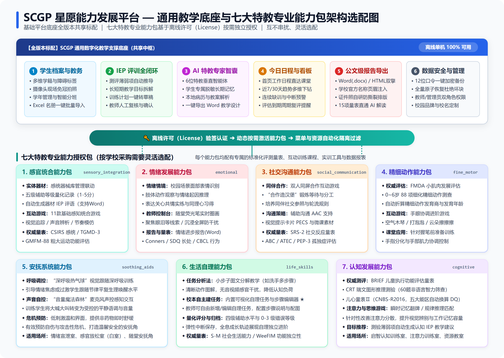

# SCGP 星愿能力发展平台 — 产品功能参数与采购选型说明书（教学实用版）

> **适用读者**：特殊教育学校校长、教导主任、资源教室教师、康复训练教师、政府采购负责人  
> **文档定位**：用于学校采购选型评审、教研组功能论证及招标文件业务功能参数编制  
> **授权机制**：平台基于**七大特教专业能力包（Entitlement Packages）**实现离线验签独立授权，学校可根据办学特色与预算按需开通、自由组合采购  
> **产品版本**：SCGP 星愿能力发展平台 V1.1.4  
> **编制单位**：杭州炫灿科技有限公司  
> **编制日期**：2026-10-13  

---

## 一、产品概述与教学应用定位

**星愿能力发展平台（SCGP）** 是一套专为特殊教育学校、普通学校随班就读资源教室、儿童康复机构打造的**一体化数字化教学与康复训练系统**。

系统紧扣国家《特殊教育办学质量评价指南》与《随班就读资源教室建设指南》要求，以**“一人一案、评训结合、家校协同、能力包按需授权”**为核心理念，深度融合：
- **通用数字教学底座**：学生全生命周期数字档案、班级学年教务、个别化教育计划（IEP）闭环系统、AI 特教智能助手矩阵、今日工作日程直达与公文级专业报告规范导出；
- **七大特教专业能力授权包**：覆盖**感官统合、情绪发展、社交沟通、精细动作、安抚系统、生活自理、认知发展**全领域，支持学校按需灵活选配；
- **学校电脑独立运行模式**：断网环境下日常教学、评估与实训 100% 正常运行，从根本上杜绝特殊学生健康隐私与学籍信息外泄风险。

---

## 二、通用教学底座功能参数清单（全版本标配）

### 1. 学生档案与班级管理（一人一案数字基石）

| 序号 | 功能模块 | 老师/采购关注的功能描述与要求 | 实用价值 |
|:---:|:---|:---|:---|
| 1.1 | 详细成长档案 | 完整记录学生学号、姓名、性别、出生日期（自动换算周岁与月龄）、障碍类别（自闭症、智力障碍、言语障碍、脑瘫、多重障碍等）；支持系统预设头像、照片上传或电脑摄像头现场拍照采集学生免冠照。 | 一键建立规范学生成长档案，避免纸质档案遗失。 |
| 1.2 | 快速检索与标签 | 支持按姓名、学号一键搜索；支持按性别、诊断类型、班级三维组合筛选。支持为学生设置个性化标签（如“无语言”、“触觉敏感”、“易冲动”、“轮椅依赖”等），便于随堂教学针对性分组。 | 1 秒定位目标学生，排课与分组教学更快捷。 |
| 1.3 | 学生综合全景视图 | 学生详情页以清晰标签页汇总：学生基本信息、历次评估记录（直达对应报告）、器材实训记录、游戏训练记录与 AI 专属记忆，实现“一屏掌握学生全部成长数据”。 | 向上级汇报、阶段教研或家长会时随时调阅全貌。 |
| 1.4 | 班级与学年管理 | 支持学校设置多个学年并一键切换当前学年；支持特教班级创建、班级最大人数设置与带教教师绑定；支持成批创建班级，大幅减轻新学期教务建班工作量。 | 规范学校教务架构，适应特教小班化教学管理。 |
| 1.5 | 智能分班与学年升级 | 支持学生在班级间灵活调班、批量分班；学年末支持一键“学年升级”，系统自动将学生顺移至高年级，并自动处理毕业年级学生的归档，完整保留学生历年班级变更历史。 | 学期交接时一键升班，告别手动重新分班的繁琐流程。 |
| 1.6 | Excel 名册批量导入 | 提供标准 Excel 学生名册模板，支持一次性批量导入全校学生名册；具备自动纠错机制（单行信息错误不影响其他学生正常导入，并明确提示错误原因）。 | 新学期开学快速批量录入学生，几分钟完成全校建档。 |

---

### 2. 个别化教育计划（IEP）全链路闭环（评训一体化）

| 序号 | 功能模块 | 老师/采购关注的功能描述与要求 | 实用价值 |
|:---:|:---|:---|:---|
| 2.1 | 测评一键推计划（评训结合） | 评估完成后，系统自动识别出学生本次测验中未通过或正在发展的薄弱项目，弹窗推荐针对性的康复器材与训练游戏；老师勾选后可**一键生成训练计划（IEP）草稿**。 | 彻底打破“评完归档、教归教、评训脱节”的特教痛点，实现测训一体化。 |
| 2.2 | 四步向导式计划编制 | 系统提供简单直观的四步编制向导：① 基本信息（计划名称、起止日期、负责老师）→ ② 设定目标（长期目标与短期分解目标）→ ③ 选编资源（从游戏库、器材库挑选教学内容，设置每周频次与训练时长）→ ④ 复核并保存草稿。 | 结构化指引，新手特教老师也能轻松规范拟定标准化 IEP。 |
| 2.3 | 计划与首页日程直通 | 审核启用的计划自动同步到系统首页的“今日工作”中。老师每天上班打开电脑，就能看到今天该给哪个学生上什么训练，点击直接进入训练，省去层层找菜单的步骤。 | 教学安排井井有条，减少备课查找时间，提升课堂执行力。 |

---

### 3. AI 特教智能助手（随身特教专家智囊）

| 序号 | 功能模块 | 老师/采购关注的功能描述与要求 | 实用价值 |
|:---:|:---|:---|:---|
| 3.1 | 6大特教专属智能体矩阵 | ★ 系统深度定制并内置 6 个针对特教教学真实痛点的垂直专家助手： ① **「一人一策」个别化教学专家**：针对特殊障碍特质，协助拟定差异化 IEP 目标、课堂调整建议与训练方案； ② **「沟通有方」课堂沟通支持专家**：针对无语言/言语障碍儿童，提供图片交换（PECS）、辅助沟通（AAC）与视觉提示支持； ③ **「成长看得见」观察与追踪助手**：协助老师开展客观行为功能分析（ABC模型）、行为频次统计与转介意见； ④ **「家校好好说」家校共育助手**：专门针对特教家长敏感心理，自动拟定得体、温暖、具同理心的微信通知、电话沟通草稿与面谈方案； ⑤ **「心晴陪伴」情绪行为干预专家**：提供学生自伤、攻击等危机行为的前事预防、平复话术与校内应急支持； ⑥ **「稳健训练」康复支持专家**：提供器械安全防护、低风险动作适配与体能训练建议。 | 为特教老师配备随身“特教专家教研室”，大幅提升教研质量与备课效率。 |
| 3.2 | 随处唤起的便捷交互 | 系统首页展示已启用智能体卡片，一键直达；并在所有页面右下角设置常驻悬浮小圆球，老师在任何教学或录入界面中遇到困难，无需退出页面随时点击即可唤出助手咨询。 | 随问随答，不打断老师当前手头正在进行的教学操作。 |
| 3.3 | 学生专属“长期记忆”沉淀 | ★ 老师与 AI 对话时可选择关联当前学生： - AI 在对话中自动捕捉该学生的性格偏好、有效强化物、敏感雷区等关键信息，形成记忆候选项； - 记忆经过系统严格自动脱敏后，由老师人工审核确认（确认/删除/置顶）； - 确认后的记忆永久保存在该学生档案中，**后续任何时候再讨论这名学生时，AI 会自动记住这名学生的特质**，给出更加契合实际的建议。 | 越用越懂这名学生，实现长期的、伴随式的因材施教。 |
| 3.4 | 拖入文档本地秒级解析 | 老师可直接将学生的既往病历、评估报告、以往教案（支持 PDF、Word、Excel 文件或观察照片）直接拖入对话框。系统在电脑本地瞬间提取文本作为分析依据，不上传原始排版文档。 | 省去手工打字粘贴大篇幅病历和资料的麻烦，快速进行学情分析。 |
| 3.5 | 一键生成排版工整的 Word 方案 | AI 为老师拟定的教学设计、干预策略或学生个案总结，点击单条回答下方的“导出 Word”或工具栏的“生成报告”，系统自动排版为标准的 Word (.docx) 文件，老师可直接打印或稍作修改使用。 | 几秒钟产出高质量教案文稿，省去排版和繁杂文档整理时间。 |
| 3.6 | 快捷指令与开场向导 | 输入 `/` 即可弹出当前专家的快捷功能（如 `/生成IEP建议`、`/家校沟通草稿`、`/行为观察小结` 等）；界面还贴心提供精选开场问题，老师点击即可开始提问。 | 即使不擅长写 AI 提示词（Prompt）的老教师也能轻松零门槛上手。 |
| 3.7 | 校园使用安全与知情管理 | 每次首次对话前弹出明确的知情同意窗口；具备危机识别保护机制（遇到严重自伤等危急情况，AI 明确提示老师启动校园属地应急处置，不给出越权建议）；管理端提供会话审计大屏，保障校园教学合规。 | 打消学校领导对大模型安全与学生隐私外泄的顾虑，合规安心。 |

---

### 4. 教学日程、看板预警与规范报告输出

| 序号 | 功能模块 | 老师/采购关注的功能描述与要求 | 实用价值 |
|:---:|:---|:---|:---|
| 4.1 | 今日工作日程大屏 | 首页清晰展示当天排班日程、待训练学生、待评估任务，老师点击即可“一键直通”训练页面，无需在复杂菜单中寻找。 | 老师每天打开软件即明确当天任务，高效开始教学。 |
| 4.2 | 教学训练进度趋势分析 | 提供近 7 天、近 30 天的动态趋势看板，展示每日训练人数、累计训练时长、计划完成率及各领域训练分布占比；点击任意日期可查看当日训练流水明细。 | 教学进度一清二楚，为教导处督导教学进度提供量化大屏。 |
| 4.3 | 智能异常与复评预警模型 | ★ 内置两大特教教学质量预警机制： ① **训练异常警示**：当学生连续缺训、成绩断崖式下跌或中途频繁中断时，系统主动亮灯提醒老师关注意外情况； ② **复评超期提醒**：系统自动跟踪学生上次评估时间，超过规定周期（如一学期）未复评时提示老师安排复评。 | 落实动态评估与教学追踪，避免个别学生被遗漏或教学脱节。 |
| 4.4 | 全息成长时间线轨迹 | 学生详情页以时间轴方式，按时间倒序汇聚该学生自入校以来的历次评估结果、IEP 计划、日常游戏与器材成绩、自理得分与教师报告，形成全生命周期的数字成长脚印。 | 调阅历史一目了然，学生毕业、升学或转学时直接导出全套成长档案。 |
| 4.5 | 一键导出专业 Word / HTML | 所有评估量表报告、情绪训练报告、器材 IEP 评语均支持一键导出为 **Microsoft Word (.docx)** 与单文件 **HTML 网页** 两种格式。 | Word 便于老师二次批注与补充评语；HTML 适合在任何电脑/手机浏览器即开即看。 |
| 4.6 | 学校公文页眉与照片浮动排版 | ★ 管理员可配置学校官方名称，导出的 Word 报告自动注入公文页眉；系统独创照片自适应浮动排版技术，学生证件照精准锚定在基本信息表右上角，**彻底解决表格被图片撑爆变形撕裂的顽疾**。 | 导出打印即是专业排版的成品公文档案，体面规范。 |
| 4.7 | 一键全量加密备份与本地隐私安全 | 管理员可一键导出全校加密数据备份包（.dat 文件），换机一键原子性还原；系统完全在本地电脑运行，断网 100% 正常使用，学生隐私不出校园。 | 保障特殊学生健康与学籍资产万无一失，符合国家等保与隐私要求。 |

---

## 三、七大特教专业能力授权包功能清单（按需选配采购）

本平台按照特殊儿童身心发展领域，划分为 **七大独立授权能力包**。每个能力包对应专门的训练主链、标准化评估量表与互动教学内容，学校可在许可证（License）中按需勾选开通：

---

### 能力包 1：感官统合能力包（`sensory_integration`）

> **适用场景**：感统训练教室建设、大肌肉运动训练室、随班就读资源教室运动感知区。

| 序号 | 业务功能 | 老师/采购关注的功能描述与要求 | 实用价值 |
|:---:|:---|:---|:---|
| 1.1 | 实体感统器材与教具库管理 | 内置特教学校常见感统器械库（平衡木、触觉球、羊角球、彩虹隧道、大陀螺、滑梯秋千等），按触觉、前庭平衡、本体觉等领域分类管理。 | 盘活学校感统教室实体资产，建立规范教具档案。 |
| 1.2 | 器材实训快速记录与五级辅助打分 | 老师在感统教室带学生做器械训练时，可一键选择器材，记录 1~5 分表现得分，并选择国际通用的五级辅助等级（独立完成、口头提示、视觉提示、手触引导、身体协助）。 | 规范记录学生器械训练全过程，辅助程度有迹可循。 |
| 1.3 | 自动生成器材 IEP 训练评语 | 系统自动汇总学生历次器材训练表现，一键生成结构化的器材训练评语和阶段建议（支持导出 Word），直接用于期末感统教学评语。 | 彻底解决感统教师期末撰写全班实训评语耗时耗力的难题。 |
| 1.4 | 基础感官统合互动训练游戏（11款） | 内置颜色配对、形状识别、视觉追踪、声音辨别、节奏模仿等 11 款基础感统数字化互动游戏，支持阶梯难度自适应与毫秒级数据自动采录。 | 适度柔和刺激，快速提升特殊儿童感知觉注意力。 |
| 1.5 | 感觉统合与运动发展标准化量表 | 内置感统与运动权威评测量表，作答完毕自动计算发育商（DQ）与发育年龄： ① **CSIRS** 儿童感觉统合能力评定量表（3~12岁） ② **TGMD-3** 大肌肉动作发展测验（3~10岁11个月，13项动作技能） ③ **GMFM-88** 粗大运动功能评估（5月~16岁，88项粗大运动） | 科学量化学生前庭、本体、触觉失调程度与大动作发育水平。 |

---

### 能力包 2：情绪发展能力包（`emotional`）

> **适用场景**：心理辅导室、孤独症情绪行为干预室、资源教室个别辅导区。

| 序号 | 业务功能 | 老师/采购关注的功能描述与要求 | 实用价值 |
|:---:|:---|:---|:---|
| 2.1 | 双向情绪情境教学链路 | 提供两条专业情绪行为训练主链： ① **情绪与场景**：在走廊、教室、操场、食堂等真实校园场景中，识别人物面部表情与肢体动作，推理情绪原因并选择恰当回应； ② **表达关心**：在同学哭泣、摔倒等真实情境中，练习共情与关心表达，理解不同表达对他人的影响。 | 帮助孤独症与情绪障碍儿童在安全虚拟情境中反复演练，降低现实冲动失控风险。 |
| 2.2 | 沉浸式全屏与防干扰设计 | 情绪训练运行时自动进入沉浸式全屏模式，隐藏常规系统菜单，避免学生注意力分散；画面风格温和、刺激适度，符合特教认知负荷规范。 | 帮助注意力缺陷与易激惹学生保持视觉专注。 |
| 2.3 | 教师互动控制台与随堂荧光笔批注 | 教师在带领情境互动时，可随时调出荧光笔工具在屏幕上实时圈画关键情绪线索（如眼泪、紧缩的眉头、紧握的拳头），并可通过控制台微调情境推进节奏与辅助提示。 | 强化课堂师生互动，直观引导特殊儿童捕捉核心社交视觉线索。 |
| 2.4 | 情绪专项进步报告 | 系统自动汇聚学生历次情绪训练数据，生成专项情绪进步报告：呈现训练总次数、平均正确率、各场景掌握情况与表现偏好，并给出差异化的教师随堂与家长家庭干预建议（支持一键导出 Word）。 | 为班主任、心理辅导教师及家长提供量化客观的情绪干预依据。 |
| 2.5 | 情绪行为标准化评估量表 | 内置情绪与行为权威评估工具，自动生成行为维度剖面图： ① **Conners PSQ** 行为问卷父母版（3~17岁） ② **Conners TRS** 行为问卷教师版（3~17岁） ③ **SDQ** 长处和困难问卷（3~16岁） ④ **CBCL** 儿童行为量表家长版（4~16岁） | 科学筛查注意力缺陷多动、攻击行为、情绪抑郁等问题行为基线。 |

---

### 能力包 3：社交沟通能力包（`social_communication`）

> **适用场景**：社交沟通多功能教室、言语语言康复室、融合教育互动区。

| 序号 | 业务功能 | 老师/采购关注的功能描述与要求 | 实用价值 |
|:---:|:---|:---|:---|
| 3.1 | 双人同屏合作社交游戏 | 支持两名特殊儿童在同一屏幕前开展合作互动游戏（如“合作造汉堡”），双方需协同分工、互相等待并同步完成操作方可通过关卡。 | 突破传统孤立的人机交互，从微观课堂实操中培养同伴轮流、合作与社交参照意识。 |
| 3.2 | 社交反应与孤独症评测量表 | 内置国际公认的社交沟通与孤独症专项标准化量表： ① **SRS-2** 社交反应量表学龄版（6~18岁，评测社交知觉、社交认知、社交沟通、社交动机及孤独症行为表现） ② **ABC** 孤独症行为评定量表（3岁以上，57题） ③ **ATEC** 孤独症治疗疗效评估量表（2岁以上，77题） ④ **PEP-3** 心理教育量表中文修订版（2~7岁，139题） | 全面诊断学生的社交障碍严重程度并量化追踪康复干预疗效。 |
| 3.3 | 沟通辅助与社交情境多媒体支持 | 结合 AI 沟通专家提供视觉提示卡片（PECS）与替代沟通（AAC）教学策略，内置社交故事与人际交往微课视频资源，辅助无语言儿童建立社交互动意图。 | 为言语障碍及低功能自闭症儿童打通社交沟通途径。 |

---

### 能力包 4：精细动作能力包（`fine_motor`）

> **适用场景**：作业治疗（OT）室、精细动作训练室、学前特教启智班。

| 序号 | 业务功能 | 老师/采购关注的功能描述与要求 | 实用价值 |
|:---:|:---|:---|:---|
| 4.1 | 小肌肉功能发展评估（FMDA） | ★ 内置专为儿童精细动作发展的 **FMDA 小肌肉功能发展评估量表**（0~6岁，共 88 项细化技能），覆盖抓握、手眼协调、双手协同等维度，作答完毕自动折算精细动作发育年龄与商数。 | 彻底解决特教学校缺乏精细动作客观评估工具的痛点。 |
| 4.2 | 手眼协调与手指灵巧度进阶游戏 | 内置“空气木琴”、“打泡泡”、“云朵擦擦擦”等手指灵巧控制与视觉追踪游戏；支持自由调节目标大小、移动速度与出现频次，适配不同手部肌力与控制水平学生。 | 针对性锻炼特殊儿童握笔前准备、手指分化与手眼协调能力。 |
| 4.3 | 精细动作 IEP 训练成果自动归档 | 游戏与评估过程中的精细动作反应时、失误类型全自动记入学生档案，支持与学期作业治疗目标（如握笔、剪纸、穿珠）闭环联动。 | 量化追踪特殊学生手部精细功能改善进程。 |

---

### 能力包 5：安抚系统能力包（`soothing_aids`）

> **适用场景**：情绪宣泄室、感官放松室（Snoezelen 白室）、学生个别安抚角。

| 序号 | 业务功能 | 老师/采购关注的功能描述与要求 | 实用价值 |
|:---:|:---|:---|:---|
| 5.1 | 声光视觉放松与呼吸调节训练 | 内置“深呼吸热气球”、“吹蒲公英”等视觉引导呼吸调控训练，引导情绪激动或焦虑的学生跟随温和视觉节奏调整深呼吸，平复生理唤醒水平。 | 为课堂突发情绪崩溃提供非药物、安全的即时平复干预工具。 |
| 5.2 | 音量感知与自我控制调节 | 内置“音量魔法森林”麦克风交互游戏，通过声控引导学生感知声音大小，训练情绪激动时的大喊大叫行为转变为受控的平静语调。 | 帮助学生建立自我声音控制与情绪自我调节意识。 |
| 5.3 | 柔和安抚交互与环境减压支持 | 提供轻柔环境音效、柔光动效与低刺激交互界面，帮助高敏触觉或感官过载儿童快速脱敏、放松神经。 | 营造温馨安全的减压环境，有效预防自伤或攻击性危机行为。 |

---

### 能力包 6：生活自理能力包（`life_skills`）

> **适用场景**：生活适应教室、培智班生活自理训练角、资源教室家政模拟区。

| 序号 | 业务功能 | 老师/采购关注的功能描述与要求 | 实用价值 |
|:---:|:---|:---|:---|
| 6.1 | 任务分析法小步子图文分解教学 | 紧扣培智学校生活适应课程标准，采用特教经典的“任务分析法”，将复杂生活自理技能拆解为有序小步骤（如“洗手”精细拆解为挽袖子、开水龙头、湿手、打香皂、搓手心手背、冲水、关水、擦干）；每个步骤均配有清晰动作图解说明与动作图片；目前版本以清晰直观的图文呈现为主，无音频与视频干扰，有效降低特殊儿童的感官认知负荷。 | 真正契合培智教育规律，手把手帮助中重度智力障碍与孤独症儿童掌握生活必需技能。 |
| 6.2 | 教师自主新增与编辑校本任务 | ★ 系统内置可视化的自理任务与步骤编辑器，特教教师可结合本校校本课程、班级学生个性化发展水平，随时自主新建、修改生活自理任务（如使用勺子进食、系鞋带、整理书包等），自由定义步骤数量、步骤说明、执行顺序与图解配图。 | 突破固定预设任务局限，支持特教教师灵活沉淀校本自理教学资源。 |
| 6.3 | 四级辅助水平与错误等级量化记录 | 随堂教学时，教师在交互界面上直接记录学生每个动作步骤的独立完成程度（独立完成、口头提示、手把手协助、无法完成），并标注错误等级（0-3级）与随堂表现备注。 | 精准量化学生每个自理小动作的依赖程度，训练成效一清二楚。 |
| 6.4 | 弹性中断与自理成长全息归档 | 支持随堂训练弹性中途保存（避免课堂突发状况导致数据丢失）；训练完成后数据自动归入全校统一训练记录主表，阶段性汇总展现学生自理技能从“高度辅助”到“部分独立”的进阶轨迹。 | 适应特教课堂突发状况多的现实，为家长反馈生活自理家庭泛化训练要点。 |
| 6.5 | 生活自理与功能独立性权威量表 | 内置生活适应权威评测工具，作答完毕自动计算社会生活年龄（SA）与独立性等级： ① **S-M** 婴儿-初中生社会生活能力量表（6月~14岁） ② **WeeFIM** 儿童功能独立性评估（0~18岁，自理、括约肌、转移、行走等） | 科学量化评定特殊儿童日常自理与社会生活适应独立能力。 |

---

### 能力包 7：认知发展能力包（`cognitive`）

> **适用场景**：认知启智训练室、注意力训练室、资源教室综合认知区。

| 序号 | 业务功能 | 老师/采购关注的功能描述与要求 | 实用价值 |
|:---:|:---|:---|:---|
| 7.1 | 执行功能与注意力权威测评 | 内置国际标准认知与执行功能测验工具： ① **BRIEF** 儿童执行功能评估（2~18岁，抑制、转换、工作记忆、监控等维度） ② **CRT** 瑞文图形推理测验（5.5~16.5岁，60题非语言智力筛查） ③ **儿心量表Ⅱ（CNBS-R2016）**（0~7岁，含大运动、精细动作、适应能力、语言、社会行为五大能区，自动换算 DQ） | 科学筛查特殊儿童的非语言认知潜能与脑高级执行功能发展水平。 |
| 7.2 | 注意力、工作记忆与逻辑归纳训练 | 内置“记忆翻牌”、“图形找规律”、“综合认知匹配”等针对性认知训练游戏，锻炼学生的瞬时记忆容量、视觉辨别力与简单逻辑推理。 | 帮助智力发育迟缓与学习障碍儿童建立基本思维习惯，改善课堂注意力分散。 |
| 7.3 | 认知长短期教学目标自动推荐 | 认知测验落后项目自动生成认知发展 IEP 目标建议，直接与注意力康复游戏建立课程关联。 | 实现认知障碍诊断与阶梯式训练的紧密衔接。 |

---

## 四、七大授权能力包采购选配方案与典型场景指南

学校与采购部门在申请财政专项预算或编制招标文件时，可根据本校特教班级类型、功能教室配置目标，灵活选配上述能力包组合：

| 推荐采购方案 | 标配底座 | 推荐开通的授权能力包代码 | 适用学校与建设场景 |
|:---|:---:|:---|:---|
| **方案 A：培智学校生活适应型** | 通用底座 | `sensory_integration` + `fine_motor` + `life_skills` | 培智学校、特殊教育部；重点聚焦生活自理、手眼协调、大肌肉感统与社会生活能力。 |
| **方案 B：孤独症情绪干预专教型** | 通用底座 | `emotional` + `soothing_aids` + `social_communication` + `cognitive` | 孤独症康复中心、特校孤独症班；重点突破情绪爆发平复、情境理解、社交合作与认知发展。 |
| **方案 C：感统康复教室专项型** | 通用底座 | `sensory_integration` + `fine_motor` | 专门用于特校或普通学校感统教室硬件器材配套数字化软件升级。 |
| **方案 D：随班就读资源教室全能旗舰版** | 通用底座 | **全开通**（全部 7 个能力包全部激活） | 普通学校随班就读资源教室、区域特殊教育资源中心、大型综合特校；满足全障碍类型儿童评估与康复。 |

---

## 五、面向负责采购领导的核心选型优势总结

在向学校领导、教育局装备处汇报或编制采购需求时，本项目具备以下 **四大核心选型价值**：

1. **【能力包级精准授权，严控预算杜绝浪费】**
   系统与业内通行的 7 大特教发展领域（感统、情绪、社交、精细、安抚、自理、认知）高度契合，采用离线验签 License 按需开通机制。学校建感统室只采购感统包，建自理室只采购自理包，新建资源教室可全开通；后续学期可平滑增购新能力包，**彻底杜绝“花大钱买了一堆用不上的功能”的资金浪费**。

2. **【评-训一体化闭环，杜绝测训脱节】**
   以往特殊学校评估后，评估结果仅作为一份纸质表格锁进档案室，无法有效指导教学。本系统在评估完成后**秒级自动生成发育年龄与商数**，并**直接关联推荐对应的康复器材、生活自理小步子、情绪情境与训练游戏**，一键生成 IEP 计划草稿，让评估数据切实指导每一堂课，契合教育行政部门对特教办学质量的考核要求。

3. **【垂直 AI 专家赋能，切实为特教教师减负增效】**
   针对特殊教育教师案头工作重、教案撰写难、家校沟通易引发误解的现实痛点，内置经过特教深度调优的 6 大垂直智能体，协助教师智能拟定个别化教案、家校沟通温和话术，并支持绑定学生长期画像。既提升了教研规范性，又极大缓解了一线特教教师的职业倦怠。

4. **【学校本地安全运行，严守学生隐私红线】**
   特殊儿童的身心障碍信息属于高度敏感的个人隐私。系统采用单机本地运行机制，不依赖外网服务器，断网环境 100% 完整运行，数据不上传第三方服务器，彻底防范学籍与健康数据外泄风险，确保学校信息化采购合规安全。
